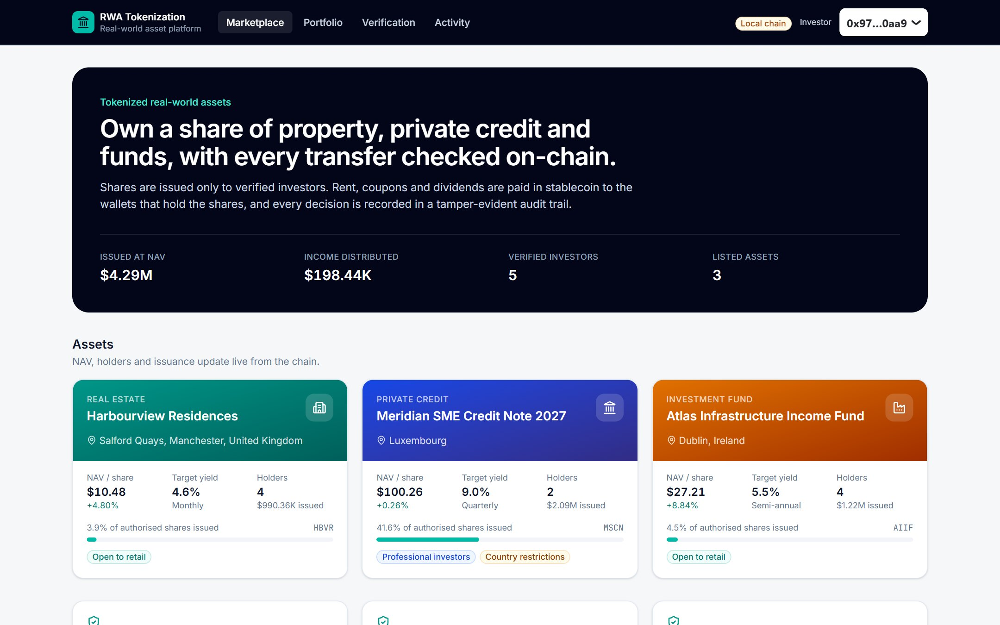
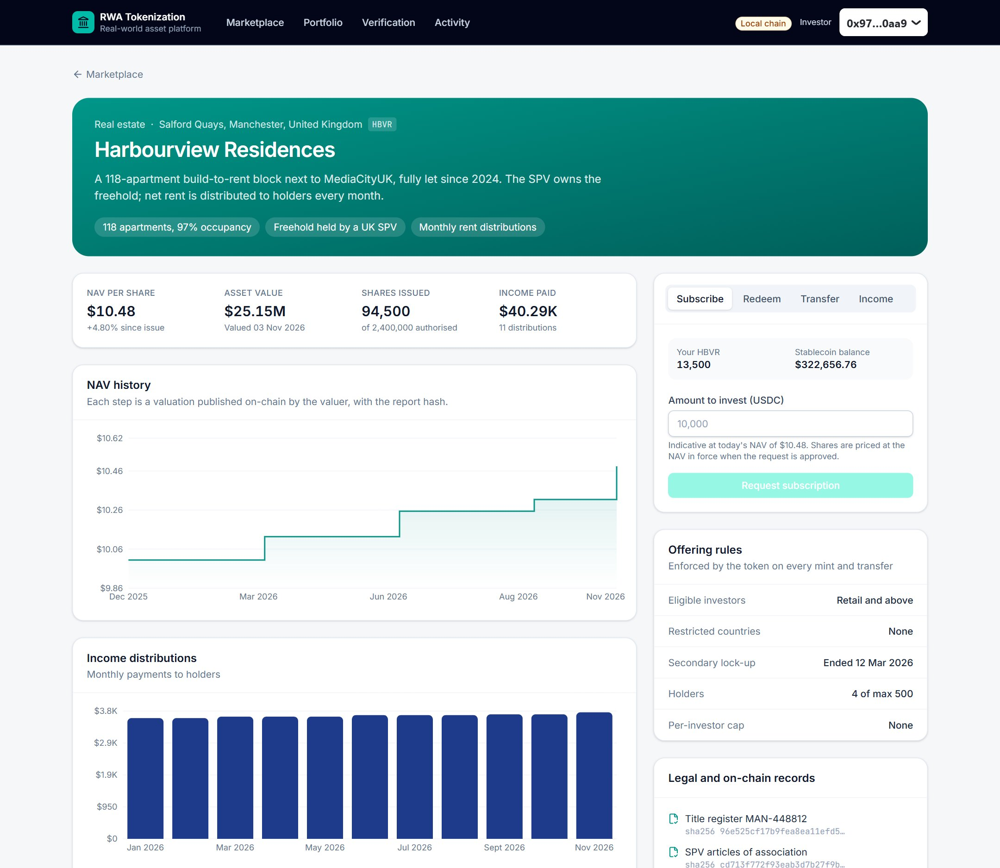
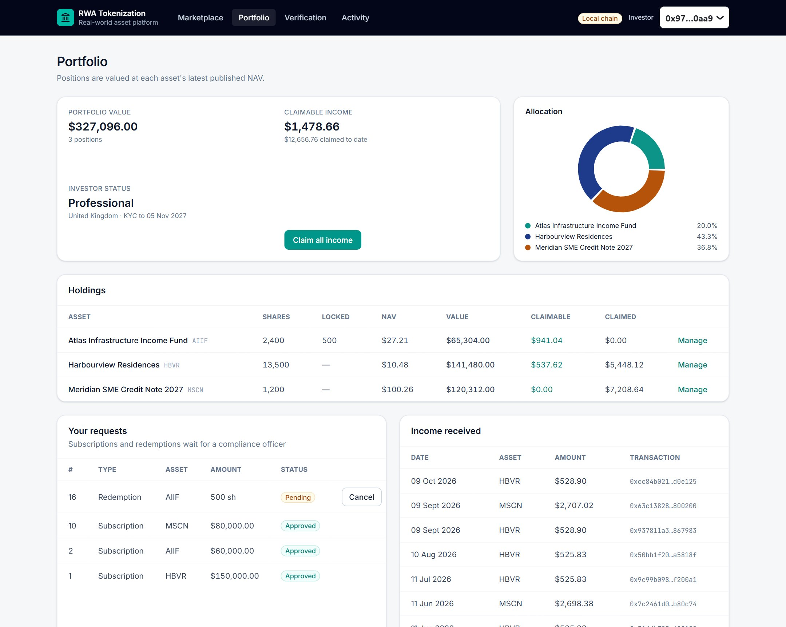
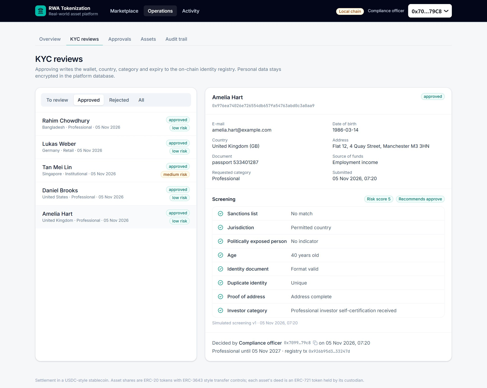
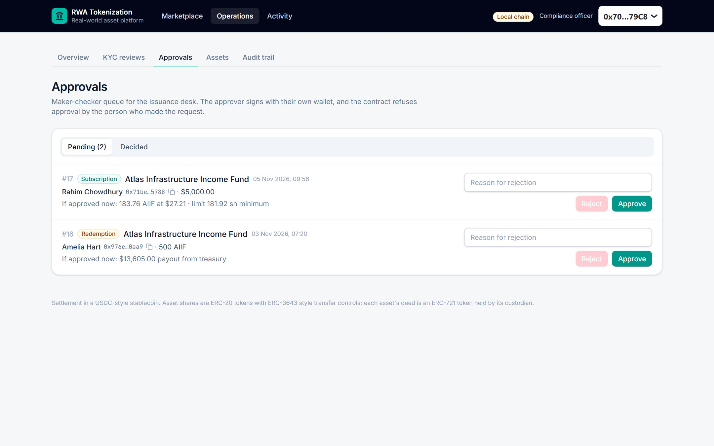
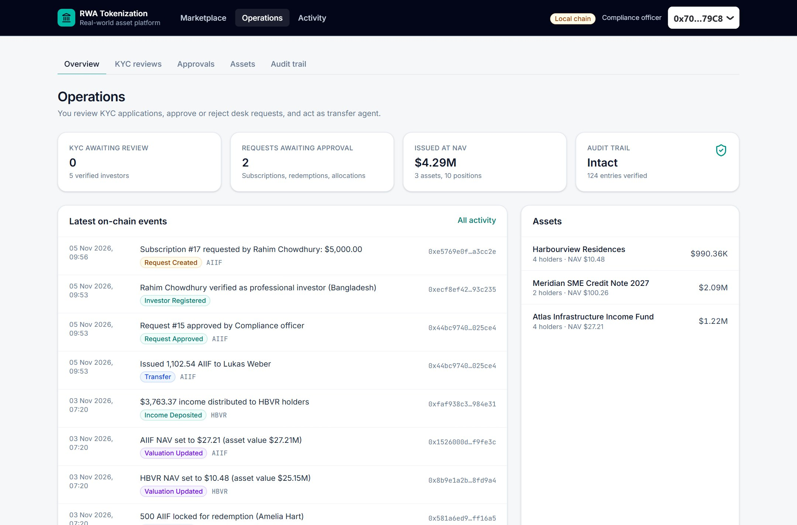
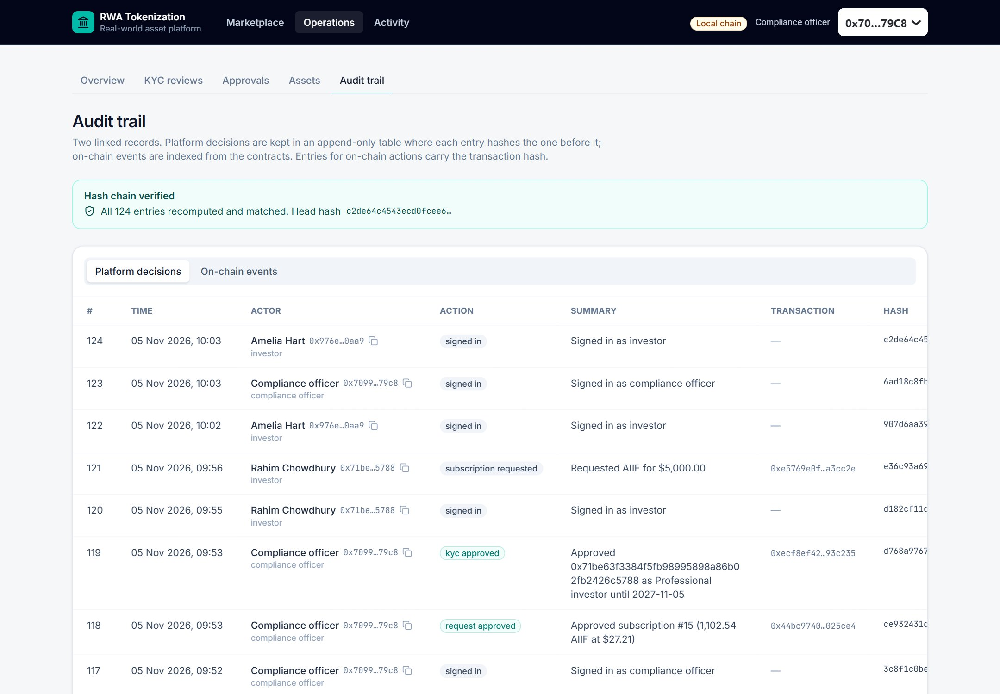
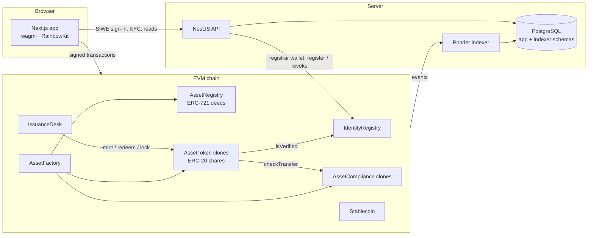

# RWA Tokenization Platform

Tokenize real estate, private credit and investment-fund shares on an EVM chain, with KYC-gated ownership,
on-chain transfer rules, stablecoin income distribution, maker-checker approvals and a tamper-evident
audit trail.



| | |
|---|---|
| **Contracts** | Solidity 0.8.28, OpenZeppelin 5.4, Foundry: 7 contracts, 74 tests (unit, fuzz, invariant), 99% line coverage, Slither clean |
| **Standards** | ERC-20 shares with ERC-3643 style controls · ERC-721 asset deeds · EIP-1167 clones · EIP-4361 sign-in |
| **Backend** | NestJS + TypeORM + PostgreSQL: wallet sign-in, KYC review with encrypted PII, hash-chained audit log |
| **Indexer** | Ponder: every platform event into PostgreSQL within a second |
| **Frontend** | Next.js 16, wagmi, viem, RainbowKit, Tailwind, Recharts: investor portal and operations console |
| **Chains** | Anvil locally; one deploy script for Arbitrum Sepolia and Polygon Amoy (any EVM chain) |

## What it does

| Requirement | How it is built |
|---|---|
| ERC-20 / ERC-721 asset representation | One **ERC-721 deed** per asset (held by the custodian SPV), one **ERC-20 share token** per asset for fractional ownership |
| Issuance and ownership contracts | `AssetFactory` creates token + compliance module + deed in one transaction; `IssuanceDesk` runs primary issuance |
| Investor registration and role-based access | `IdentityRegistry` whitelist; OpenZeppelin `AccessControl` roles on every contract; staff roles mirrored in the API |
| KYC / whitelist and transfer restrictions | Off-chain KYC with simulated screening → on-chain registry; token checks verification, freeze, locks and per-asset rules on every transfer |
| Dividend / rental income distribution | Pull-based income per share in a USDC-style stablecoin: constant gas per payment, correct across transfers |
| Valuation and transaction history dashboard | NAV history charts, income history, share register, portfolio, cap table, live activity feed |
| Admin approval, redemption and audit trail | Maker-checker desk for subscriptions, redemptions and allocations; append-only hash-chained audit log + indexed chain events |

## Screens

| Asset detail | Portfolio |
|---|---|
|  |  |
| **KYC review** | **Maker-checker approvals** |
|  |  |
| **Operations overview** | **Audit trail** |
|  |  |

## Architecture



More detail, including the flows for KYC, subscription, redemption and income, is in [docs/ARCHITECTURE.md](docs/ARCHITECTURE.md).

### Smart contracts

| Contract | Purpose |
|---|---|
| [`IdentityRegistry`](contracts/src/IdentityRegistry.sol) | Whitelist of verified wallets: country (ISO numeric), investor tier, KYC expiry. No personal data on-chain. |
| [`AssetToken`](contracts/src/AssetToken.sol) | ERC-20 shares of one asset. Checks verification, freezes, partial locks and compliance on every mint and transfer; forced transfer and lost-wallet recovery for the transfer agent; NAV; income distribution. |
| [`AssetCompliance`](contracts/src/AssetCompliance.sol) | Per-asset offering rules: minimum investor tier, blocked countries, maximum holders, per-investor cap, lock-up. Swappable without touching the token. |
| [`AssetRegistry`](contracts/src/AssetRegistry.sol) | ERC-721 deed per asset: class, jurisdiction, document hash, metadata URI, lifecycle status. Deeds move only by admin custody transfer. |
| [`AssetFactory`](contracts/src/AssetFactory.sol) | Clones token + compliance (EIP-1167), mints the deed and wires operator roles. |
| [`IssuanceDesk`](contracts/src/IssuanceDesk.sol) | Primary market. Subscriptions escrow stablecoin and mint at the NAV in force at approval; redemptions lock shares, then burn and pay NAV from the treasury; allocations need a second person. |
| [`MockUSDC`](contracts/src/MockUSDC.sol) | Six-decimal stablecoin for local chains and testnets. Real networks pass an existing stablecoin. |

### Roles

| Role | Contracts | Can |
|---|---|---|
| Platform admin | all (`DEFAULT_ADMIN_ROLE`) | manage roles, swap compliance modules, set treasury, move deed custody. Use a Safe multisig. |
| Compliance officer | desk `APPROVER`, token `AGENT`, compliance `COMPLIANCE` | approve or reject requests, freeze wallets, pause trading, forced transfers, wallet recovery, edit rules |
| Asset manager | factory `ASSET_MANAGER`, desk `OPERATOR`, registry `RECORDS` | tokenize assets, propose allocations, update documents and status |
| Valuer | token `VALUATOR` | publish NAV with the valuation report hash |
| Treasury | token `DISTRIBUTOR`, desk treasury, deed custodian | deposit income, fund redemptions, receive subscription money |
| KYC service (API) | registry `REGISTRAR` | write approved investors to the registry |

The desk refuses approval by the wallet that made the request (`SelfApproval`), so every share movement it
controls involves two people.

### Transfer rules

`AssetToken.transferStatus(from, to, amount)` returns a reason code before anyone signs; the same check runs
inside the token and reverts with `TransferRejected(code)`.

| Code | Meaning | Code | Meaning |
|---|---|---|---|
| 1 | Asset paused | 8 | Lock-up still running |
| 2 / 3 | Sender / receiver frozen | 9 | Receiver tier below minimum |
| 4 / 5 | Sender / receiver not verified | 10 | Receiver country restricted |
| 6 | Amount above balance | 11 | Holder limit reached |
| 7 | Shares locked for redemption | 12 / 13 | Per-investor cap / supply cap |

### Income distribution

Each `depositIncome` adds `amount × 1e36 / totalSupply` to `incomePerShare`. Before any balance changes, the
token books what both accounts earned at their old balances. Holders claim whenever they like (pull model),
so a payment costs the same gas for 4 holders or 40,000, shares bought after a payment earn nothing from it,
and locked shares keep earning until they are redeemed. Fuzz and invariant tests check that claims never
exceed deposits and that the token always holds enough stablecoin for every claim.

### Audit trail

* **Platform decisions** (sign-ins, KYC submissions and decisions, asset profiles, and every on-chain action a
  user signs in the app) go into `app.audit_log`. Each row stores `sha256(previous hash ‖ canonical JSON)`;
  a PostgreSQL trigger blocks `UPDATE`, `DELETE` and `TRUNCATE`; `GET /audit/verify` recomputes the chain.
  Entries for on-chain actions are accepted only after the API checks the receipt: successful, sent by the
  signed-in wallet, addressed to a platform contract.
* **On-chain events** from every contract are indexed in order into the `activity` table.

## Run it locally

Prerequisites: Node.js 22.12+, pnpm 10, Docker, [Foundry](https://book.getfoundry.sh/getting-started/installation).

```bash
git clone --recurse-submodules https://github.com/sadrulemail/rwa-tokenization-platform.git
cd rwa-tokenization-platform
pnpm install
pnpm db:up                 # PostgreSQL on localhost:5433
pnpm chain                 # Anvil on :8545, clock starts 400 days back (keep running)
pnpm deploy:local          # second terminal: deploy contracts + export ABIs
pnpm dev                   # API :4000, indexer :42069, web :3000
pnpm seed                  # third terminal: replay about 11 months of activity
```

Open http://localhost:3000 and choose a wallet under **Local node** in the connect dialog. These are Anvil's
development accounts, so every role can be used without a browser extension:

| Wallet | Role | State after `pnpm seed` |
|---|---|---|
| Platform admin | Admin | all admin roles |
| Compliance officer | Approver, transfer agent | 2 desk requests waiting |
| Asset manager | Asset manager | 3 assets listed |
| Valuer | Valuer | monthly / quarterly NAV history |
| Treasury | Treasury | funds income and redemptions |
| Amelia Hart | Investor, UK, professional | holds all three assets |
| Daniel Brooks | Investor, US, professional | blocked from the Reg S credit note |
| Tan Mei Lin | Investor, Singapore, institutional | largest holder |
| Lukas Weber | Investor, Germany, retail | cannot buy the professional-only note |
| Sofia Marino | Applicant | KYC rejected |
| Rahim Chowdhury | Applicant | KYC waiting for review |

No configuration is needed locally: every service has defaults for this setup. See each app's `.env.example`
to override them.

### Run with Docker

The three apps are published on Docker Hub (linux/amd64):
[`sadrulemail/rwa-api`](https://hub.docker.com/r/sadrulemail/rwa-api),
[`sadrulemail/rwa-indexer`](https://hub.docker.com/r/sadrulemail/rwa-indexer) and
[`sadrulemail/rwa-web`](https://hub.docker.com/r/sadrulemail/rwa-web). They run against the local chain
instead of `pnpm dev`:

```bash
pnpm chain                                          # Anvil on :8545 (keep running)
pnpm deploy:local                                   # second terminal
docker compose -f docker-compose.images.yml up -d   # API :4000, indexer :42069, web :3000, own PostgreSQL
pnpm seed                                           # optional
```

The images are built from the root `Dockerfile`, one target per app:

```bash
docker build --target api     -t sadrulemail/rwa-api .
docker build --target indexer -t sadrulemail/rwa-indexer .
docker build --target web     -t sadrulemail/rwa-web .
```

Contract addresses and the web app's `NEXT_PUBLIC_*` values are compiled in, so the published images
target Anvil and a browser on the same machine. For another chain, deploy first, then rebuild with
`--build-arg NEXT_PUBLIC_API_URL=… --build-arg NEXT_PUBLIC_CHAIN_ID=… --build-arg NEXT_PUBLIC_RPC_URL=…`
for the web image. The API image runs with `NODE_ENV=production`, which requires every secret in
`apps/api/.env.example`; the compose file switches it to the local defaults.

## Tests and checks

```bash
pnpm contracts:test                        # 74 Foundry tests: unit, fuzz (1,000 runs), 6 invariants
cd contracts && forge coverage --report summary --no-match-coverage "(test|script)/"
cd contracts && python -m slither .        # 0 findings (config: contracts/slither.config.json)
pnpm --filter @rwa/api test                # audit hash chain, PII encryption, screening, config
pnpm --filter @rwa/web test                # formatting and pricing helpers
pnpm typecheck && pnpm lint && pnpm build
```

`pnpm seed` doubles as an end-to-end run: it signs in investors and staff with SIWE, submits and reviews KYC
through the API, lists assets, subscribes, distributes income, transfers, freezes, redeems, and finally
verifies the audit chain.

Invariants checked over random call sequences: balances add up to supply; holder count matches non-zero
balances; locked shares never exceed the balance; income held equals deposited minus claimed and covers
everything owed; only verified wallets hold shares; supply stays within the cap.

## Deploy to a testnet

1. Copy `.env.example` to `.env`, set `DEPLOYER_PRIVATE_KEY` (a fresh testnet key with faucet gas) and the role
   addresses. Use a Safe for `ADMIN_ADDRESS`.
2. `pnpm deploy:arbitrum-sepolia` or `pnpm deploy:polygon-amoy`. This writes `contracts/deployments/<chainId>.json`
   and regenerates `packages/contracts`. It verifies the contracts when `ETHERSCAN_API_KEY` is set.
3. Run the API with `CHAIN_ID`, `RPC_URL`, `REGISTRAR_PRIVATE_KEY`, `JWT_SECRET` and `PII_ENCRYPTION_KEY`;
   the indexer with `CHAIN_ID`, `RPC_URL` and `DATABASE_URL`; the web app with `NEXT_PUBLIC_CHAIN_ID`,
   `NEXT_PUBLIC_API_URL` and `NEXT_PUBLIC_WALLETCONNECT_PROJECT_ID`.

## Project structure

```
contracts/            Foundry project: src/, test/ (unit, invariant), script/Deploy.s.sol, deployments/
packages/contracts/   ABIs, deployment addresses and shared constants for every app
apps/api/             NestJS API: auth (SIWE), kyc, audit, market read models, asset profiles
apps/indexer/         Ponder config, schema and event handlers
apps/web/             Next.js app: marketplace, asset pages, portfolio, verification, operations console
scripts/              local chain, deploy, ABI export and the seed scenario
docs/                 architecture, security notes, screenshots
```

## Security notes

This code has not had an external audit; get one before any mainnet deployment. KYC screening is
simulated: plug a real provider in behind `ScreeningService`. Read [docs/SECURITY.md](docs/SECURITY.md)
for the controls in place and the known limitations.

## License

[MIT](LICENSE) © 2026 Sadrul Alom
