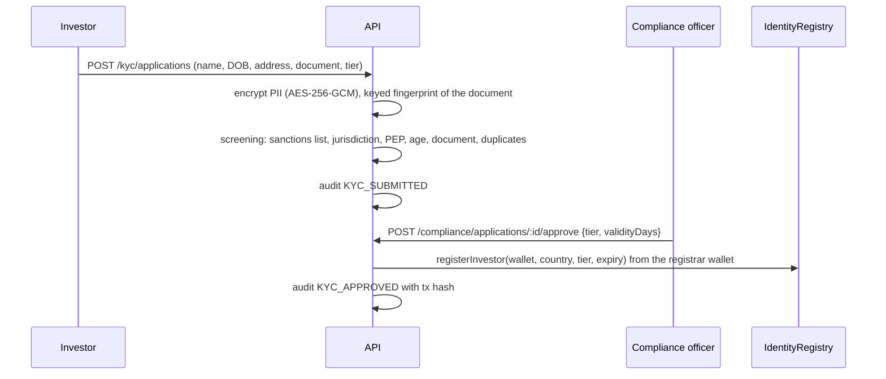
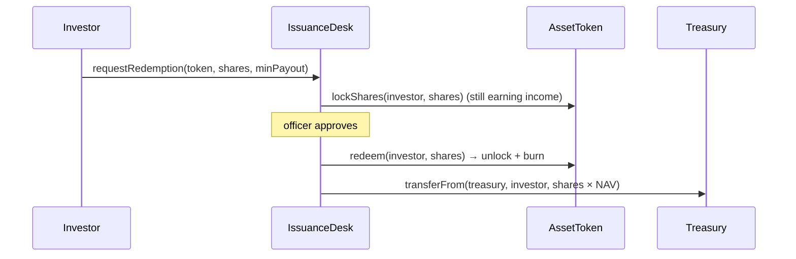

# Architecture

## Components

| Component | Runs | Owns |
|---|---|---|
| Smart contracts | EVM chain | ownership, eligibility, rules, NAV, income, requests |
| API (`apps/api`) | Node.js, port 4000 | sessions, KYC applications (encrypted), asset profiles, audit log, read models |
| Indexer (`apps/indexer`) | Node.js (Ponder), port 42069 | event tables in the `indexer` schema |
| Web (`apps/web`) | Next.js, port 3000 | investor portal and operations console |
| PostgreSQL | Docker, port 5433 | `app` schema (API), `indexer` schema (Ponder) |

The chain is the source of truth for anything that moves value. The API holds what must not be public
(personal data) and records who decided what. The indexer turns events into tables the dashboards can query.

## Sign-in

```mermaid
sequenceDiagram
  participant W as Web app
  participant Wallet
  participant API
  W->>API: GET /auth/nonce
  API-->>W: nonce (single use, 10 min)
  W->>Wallet: sign EIP-4361 message (domain, chain, nonce)
  Wallet-->>W: signature
  W->>API: POST /auth/verify {message, signature}
  API->>API: check domain, chain, nonce; verify signature (EOA or ERC-1271)
  API-->>W: JWT {sub: wallet, role}
```

Roles come from the deployment record: the admin, officer, operator, valuer and treasury addresses map to
staff roles; any other wallet is an investor.

## Investor onboarding (KYC)



A REJECT recommendation can only be approved with a written override reason, which is kept in the audit
log. Revocation removes the wallet from the registry; the token then refuses transfers to and from it.

## Subscription (forward pricing)

```mermaid
sequenceDiagram
  participant I as Investor
  participant D as IssuanceDesk
  participant T as AssetToken
  participant O as Officer
  I->>D: requestSubscription(token, payment, minShares)
  D->>D: escrow stablecoin, status Pending
  O->>D: approve(id) (must differ from requester)
  D->>T: shares = payment × 1e18 / NAV; require ≥ minShares
  D->>T: mint(investor, shares) → identity + compliance checks
  D->>D: forward stablecoin to treasury
```

Reject or cancel refunds the escrow. A mint that breaks a rule (country, tier, holder cap, supply cap) reverts
the approval, so the officer rejects it with a reason instead.

## Redemption



## Income

```text
deposit:  incomePerShare += amount × 1e36 / totalSupply
accrue:   owed[a] += balance[a] × (incomePerShare − paid[a]) / 1e36 ; paid[a] = incomePerShare
          (runs for sender and receiver before every balance change)
claim:    pay owed[a] in stablecoin
```

## Clones instead of upgradeable proxies

Each asset gets an EIP-1167 clone of a fixed implementation. Clones are cheap to deploy and cannot be
upgraded, so nobody can change a live token's logic. What does need to change, such as offering rules or
the KYC source, sits behind addresses the admin can repoint (`setCompliance`, `setIdentityRegistry`).

## Data model

### `app` schema (API)

| Table | Notes |
|---|---|
| `app_user` | wallet, role, last sign-in |
| `auth_nonce` | single-use SIWE nonces |
| `kyc_application` | `*_enc` columns are AES-256-GCM; screening result as JSON; decision, tx hash, expiry |
| `audit_log` | `prev_hash`, `hash`; trigger blocks UPDATE/DELETE/TRUNCATE; unique (tx_hash, action) |
| `asset_profile` | description, highlights, documents; served as the deed's `tokenURI` JSON |

### `indexer` schema (Ponder)

`asset`, `valuation`, `holding`, `share_transfer`, `distribution`, `income_claim`, `desk_request`,
`investor`, `compliance_rules`, `activity`. Amount columns are `numeric(78,0)` and keep full precision.
